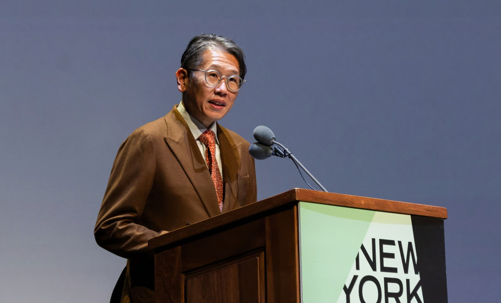
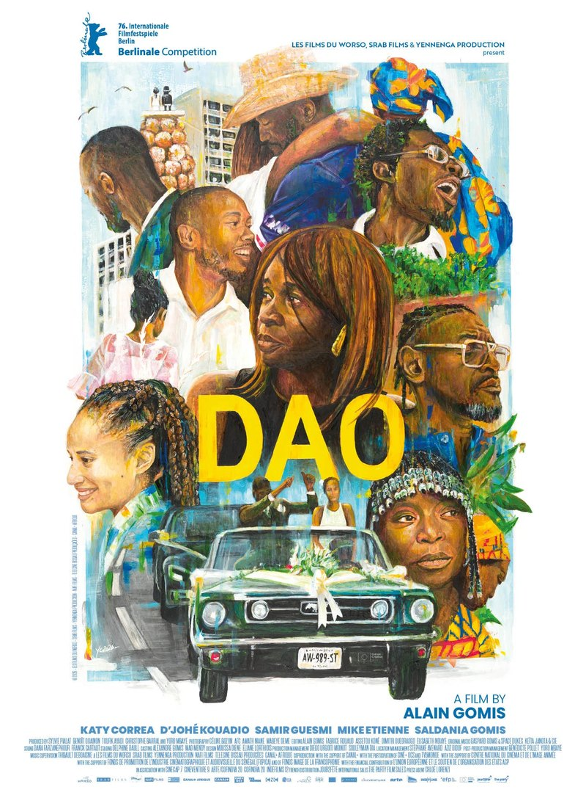
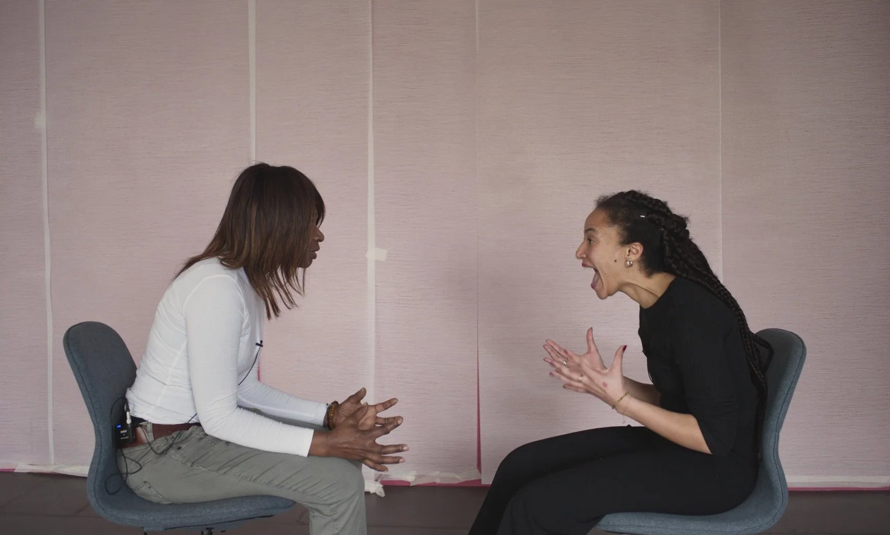
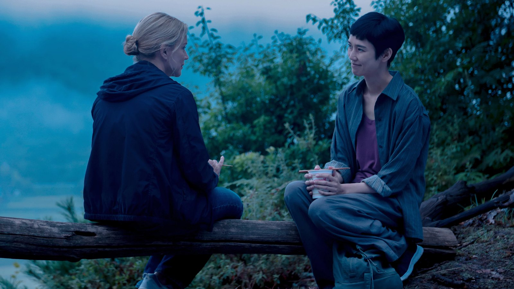
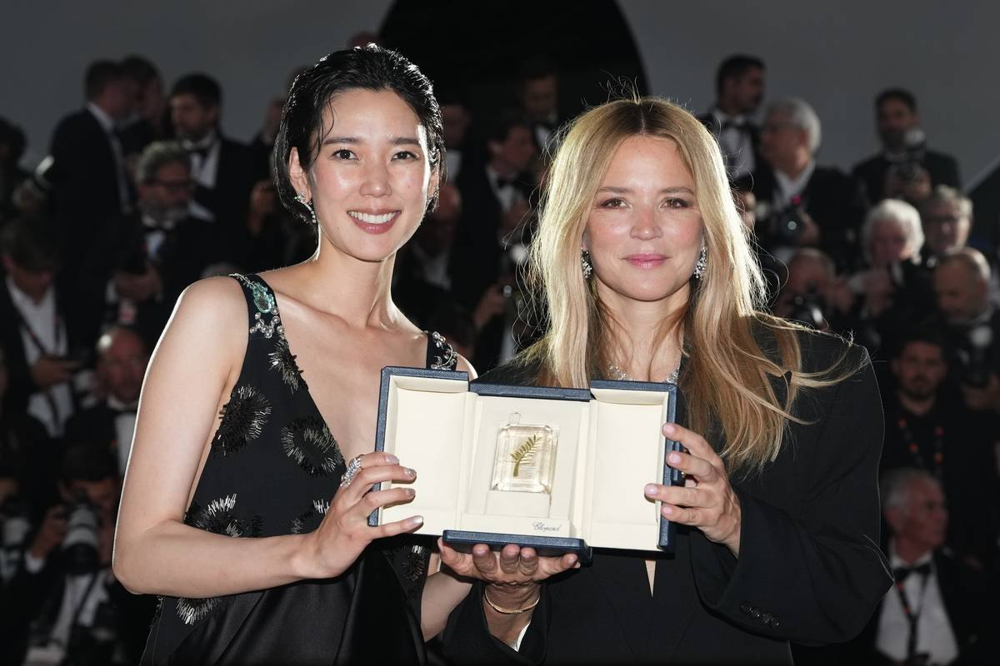
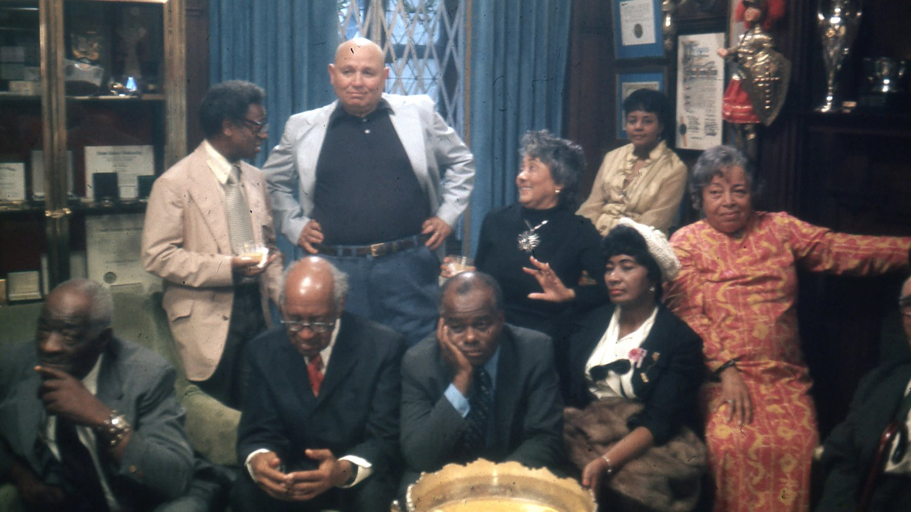
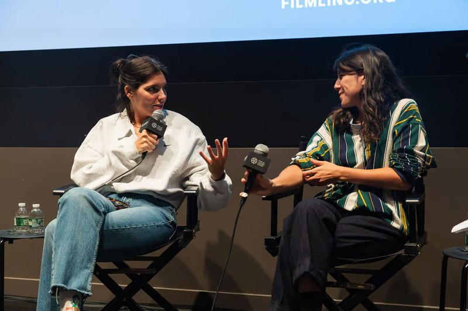

The fall and regional film festival season has fully commenced. With that, one of the standard-bearers of American international film festivals, the New York Film Festival (NYFF), has completed its two-week run with its 64th installment. Having attended, I found comments from Daniel Stern, Chairman of Film at Lincoln Center, and Dennis Lim, Artistic Director of NYFF, particularly illuminating about the festival’s convictions and programming objectives. During the introduction to James Gray’s Opening Night film, *Paper Tiger*, Stern stated that the goal is to highlight the best of world cinema thus far in the year (from festivals such as Berlin, Venice, Cannes, Telluride, etc.), while also illuminating new voices and the venerable auteurs who help progress the medium of filmmaking. During his tenure as artistic director, Lim has also curated a more eclectic selection rather than relying on films that would garner the most attention due to perceived “awards buzz.” Of course, the festival has its fair share of star-studded Q&As and red carpet moments. Still, they feel tied to an overarching philosophy: highlighting the best in international filmmaking, or those who hail from the Greater New York area.

<figure class="article-graphic">

<figcaption>Source · Film at Lincoln Center</figcaption>
</figure>

This year, I felt their convictions in full force through each section I attended, including the Main Slate, Spotlight, Currents, and Revivals, which recognized the common thread of discovery, yet films presciently aware of the current state of politics, social culture, and the film industry at large. What I admire most about NYFF is its concise yet diverse curation, which values quality over quantity while remaining steadfast in its pursuit of showcasing films that push the envelope formally and thematically. Buzzy World Premieres felt more closely tied to the greater New York area and its filmmakers, complementing the “homecoming” sentiment shared across the various sections. Having just completed my second stint attending the NYFF, I wanted to share a few personal highlights from my thirteen days at the 64th New York Film Festival.

<h2><em>Dao</em> — Alain Gomis (Main Slate)</h2>

<figure class="article-graphic">

<figcaption>Source · TMDB</figcaption>
</figure>

One of the best examples of NYFF programming, and the “discovery” feeling I get while attending, is a film like [*Dao*](https://boxd.it/GWqO) by Alain Gomis. Premiering at the Berlin International Film Festival this past year, *Dao* was one of the most boundary-pushing films I have seen in quite some time, and at the very least, of the festival. Centered on an African mother, her daughter, and their extended family, *Dao* is a spellbinding, intersecting tale of two celebrations that run almost in circular fashion: a funeral-like ceremony in their fatherland, Guinea-Bissau, and the daughter’s wedding in France, where they presently reside. I found Gomis’ work culturally rich, powerful, and effervescent, weaving narratives about one family during two parallel yet almost intersecting cultural celebrations: a funeral ritual in their motherland, Guinea-Bissau, and a wedding in France. The way the rituals and celebrations are filmed and detailed almost feels like a documentary, bridging narrative conventions and simulation, with documentary elements such as showing Gomis consulting and collaborating with the cast itself. Since the film is composed largely of actors with first credits to screen, Gomis intercuts pre-production and rehearsal interviews, along with cast questions, with simulations of the film’s main plots. The purpose of this, to me, is to achieve a clear understanding and familiarity with actors’ desires in being in a film like this, and what misguided xenophobic stigmas they wish to dispel about Africa and their rituals that seem “barbaric” to the communities outside of their own. Gomis’ behind-the-scenes approach helps make the characters fully realized, and the family feels universally relatable as we see common threads between the actors’ personal sensibilities and their characters in the film. Personal anecdotes, paired with contrasting scenes of Africa and France, highlight their shared communal nature, and Gomis offers a bridge of universality and empathy.

Gomis masterfully evokes a sense of self-preservation of heritage and culture in African Nations while acknowledging assimilation through the African diaspora and the splintering of family trees that ensues. The film is never sensationalist; instead, it warmly invites the audience to embrace this family. In his Q&A, Gomis shared that these funeral rituals reflected his own experiences and that he felt compelled to tell this story to break implicit social barriers while keeping the sanctity and dignity of what could be considered “outsiders” intact. Gomis executes with full marks, and *Dao* articulates to screen evolving generational values and motivations of a family through a diaspora, depicting themes around underlying stigma around interracial relationships, the strain that accompanies not keeping in touch with the family back in their home nation beyond sending money, and the liberty that comes with knowing where one’s ancestors came from and how immutable that can be.

<h2><em>All of a Sudden</em> — Ryusuke Hamaguchi (Main Slate)</h2>

<figure class="article-graphic">

<figcaption>Source · TMDB / The Japan News</figcaption>
</figure>

Ryusuke Hamaguchi’s latest feature, [*All of a Sudden*](https://boxd.it/UMOO), has emerged as my favorite film of the year. A film so sincere in its socio-political implications and philosophical convictions that I struggle not to wax poetic about what makes it so special to me. Frustrated by corporate conventions that prioritize profit and a green bottom line, Marie-Lou (played by Virginie Efira), director of a senior living facility, persists in grounding the facility in a “Humanitude” methodology of practice, no matter the cost. Colleagues and bosses resist Marie-Lou, yet in a sense of divine coincidence, her vocation and life are profoundly shifted by her newfound friendship with Mari (Tao Okamoto), a Japanese playwright recently diagnosed with an aggressive form of cancer.

Hamaguchi has a way with dialogue that makes long, elaborate conversations feel necessary and focused, a trait that has earned him praise and become one of his greatest calling cards. A three-hour-and-sixteen-minute runtime feels anything but monotonous, thanks in part to Efira and Okamoto, whose philosophical probing of each other I relished. In a world so stricken by division and negativity, Hamaguchi offers a humanitarian outlook on platonic relationships and companionship. There is a moment in which Okamoto says to Efira that things leave us when they don’t serve us anymore, and “humans come into each other’s lives when they are ready for them.” To me, this underscores everything I love about this film and how it has imprinted itself on my outlook on life. *All of a Sudden* offers compassion amid frustration in uncertain times, both at work and in leisure, and empathy in situations of fear, like the weight of unpacking our own mortality. To keep things brief, I implore readers to watch this film, which champions everything we love about relationships and what it means to be alive through friendship. A warm embrace from a master like Hamaguchi will always be welcome.

<h2><em>Once Upon a Time in Harlem</em> — William and David Greaves (Main Slate)</h2>

<figure class="article-graphic">

<figcaption>Source · TMDB</figcaption>
</figure>

At the film’s festival introduction, the archival documentary [*Once Upon a Time in Harlem*](https://boxd.it/ZsJa) was hailed as one of the most “quintessentially New York” films. To no surprise, it was, and for good measure. Though it premiered at Sundance Film Festival this past January, the NYFF audience met this homecoming event with enthusiasm, and it shed light on the luminaries of the Harlem Renaissance. From poets, authors, entertainers, and artists to historians, the film brought together contributors to one of American history’s most influential periods. Black visionaries gathered in Duke Ellington’s old apartment to reminisce and share memories of the period that became synonymous with Black culture in the United States. Their conversations had a flair that matched the era. Lively discussions and even socio-political disagreements, like debates about the intent of activists such as Marcus Garvey, were always in good faith, and the goal was to create a time capsule for future generations, so we don’t forget the contributions of those before us. To me, seeing these figures in real time realize and share their legacies was truly empowering, as a young Black man, circling back to the imperative of understanding one’s ancestors and the cultural footprint that accompanies it. Listening to actor Leigh Whipper perform monologues, historians relaying the details surrounding Black theatrical productions like *Shuffle Along* — an act of defying the constraints of what was deemed impossible for an all-Black production (a black romantic comedy), and artist Aaron Douglas dictating the motivations of his paintings such as “Aspects of Negro Life: Slavery Through Reconstruction” moved me in a formative way and sparked a spirit of pride that was fanned beautifully by the archival work of the legendary Greaves family.

<h2><em>La Gradiva</em> — Marine Atlan (Main Slate) and <em>A Day in the Life of Jo: Chapter Phaedra</em> — Jacqueline Lentzou (Currents)</h2>

<figure class="article-graphic">

<figcaption>Lentzou (left) and Atlan (right) at their “Talk” session at the 64th New York Film Festival · Source · Film at Lincoln Center</figcaption>
</figure>

[*La Gradiva*](https://boxd.it/HGtE) has emerged as one of this year’s most acclaimed discoveries, and for good reason. On our own website, [Arnaud Weissenburger](/review.html?slug=cannes-2026-retrospective) shone a spotlight on Marine Atlan’s debut feature, which I am glad to co-sign. He eloquently details *La Gradiva*’s universal coming-of-age pull and how it plays within the subgenre while staying fresh and self-aware. To continue that conversation, I would like to submit [*A Day in the Life of Jo: Chapter Phaedra*](https://boxd.it/WbJ2) from Jacqueline Lentzou, who won Best Director in the Orizzonti section at the 83rd Venice Film Festival. Lentzou’s feature shares much in thematic conversation with Atlan’s, as both young filmmakers highlight the spiritual and social awakening of melancholic youth in different ways. *A Day in the Life of Jo* does so in a more melodramatic yet surreal tone, following a high school girl (Jo, played by Evita Andriopoulou) on a fateful day in her young life. Lentzou methodically shifts between the universe’s sublime, astral, and physically tangible realities, slowly feeding visions of symbols that foreshadow moments that will define this pivotal day in Jo’s life. The film also features one of the year’s best needle drops: Vashti Bunyan’s “I’d Like to Walk Around In Your Mind,” which serves as a lyrical throughline for the film’s more abstract moments. What I loved most about Jacqueline Lentzou’s sophomore outing is how it confidently blends the abstractness of its dream state with coming-of-age tendencies for a more ethereal experience. I found it easy to bring these two films into conversation, as the festival’s programming team decided to have Atlan and Lentzou participate in the “Talks: Crosscut” section, where filmmakers from different sections share a conversation about their films.

The 64th New York Film Festival was a fulfilling one for me. The curation was wonderful, and many films resonated with me personally, leaving me with discoveries I will cherish. If you ever get the chance to catch a few films at NYFF, I highly recommend it. Their scope and dedication to international cinema are vast, and you can wear many different hats as a festivalgoer, as I did this year. Their pride in bringing back the masters of the medium and giving them their flowers is a huge calling card, and seeing these masters give lectures and thoughtful discussions will always be appreciated. That said, leap to research and find those gems like *Dao* or *A Day in the Life of Jo: Chapter Phaedra*, as well as the plethora of revelations in the “Currents” and “Shorts” section. The most rewarding moments for me come from the communion of cinephiles of all sorts that accompanies this festival, where the onus is on expanding perspective rather than staying within our proverbial boxes of entertainment. NYFF has exponentially broadened my awareness of World Cinema, so attending it has become a yearly goal for me.
